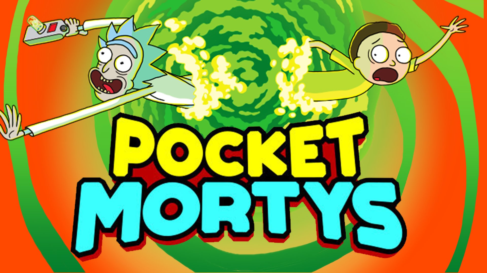

# Pocket Mortys RE:VIVED

A work-in-progress **offline Windows port** of *Pocket Mortys* — the Rick & Morty mobile card-battler by Big Pixel Studios. The goal: the complete single-player campaign playable on PC with **no online connection required**. No servers, no sign-in, no cloud — everything runs and saves locally.

## What's working

- Full opening flow: garage intro, Council of Ricks cutscene, tutorial battles, catching your first Mortys
- Overworld exploration (keyboard: **arrow keys** to move, **A / Space** to interact & advance dialogue)
- Turn-based battles: attacks, items, switching Mortys, catching wild Mortys, buff/debuff animations
- Inventory & item menus, settings screens, local autosaves
- Purchases with Schmeckles work
- Broken UI popups and battle animations repaired (dialogue boxes, confirmation popups, move effects)

## Known bugs

Playtester-confirmed issues currently being worked on:

- Characters **bob / duck into the ground** while walking
- **Black screen** after certain cutscenes and Citadel transitions
- Battle **"Switch your Morty" menu can softlock** (no options render)
- Online-only features (e.g. the Schmeckle Bank) show *"An online connection could not be made"* — being converted to fully offline
- Extra interact keys (Z / X / Enter) planned alongside A

## Building from source

1. Install **Unity 2018.4.36f1**
2. Open the `ExportedProject` folder in Unity
3. Run `PocketMortys.EditorTools.BuildPlayer.Build` (or File → Build Settings → Build)

Project files are being prepared for upload (large assets require Git LFS).

## Disclaimer

Fan-made preservation project. Not affiliated with Adult Swim, Big Pixel Studios, or the creators of Rick and Morty. All game assets, names, and artwork belong to their respective owners. This repository does not host game files.

---

*Original game © Big Pixel Studios / Adult Swim Games.*
